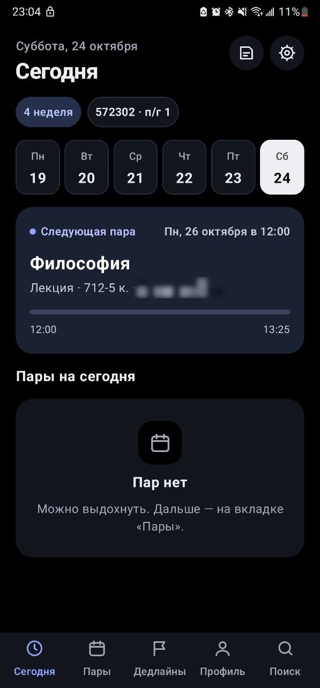
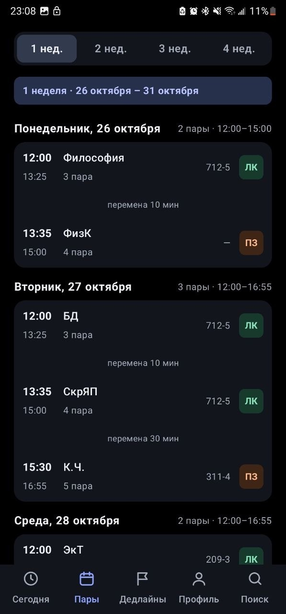
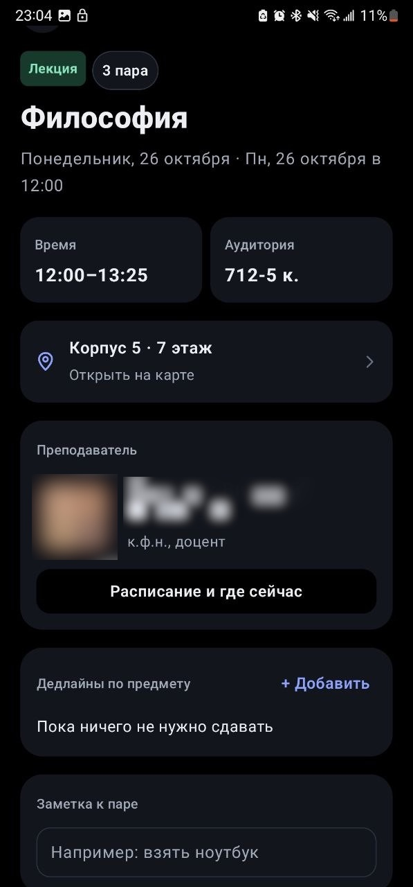
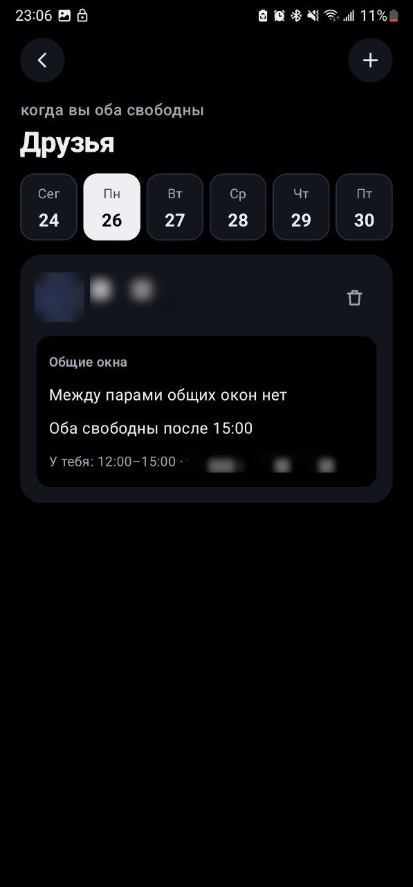
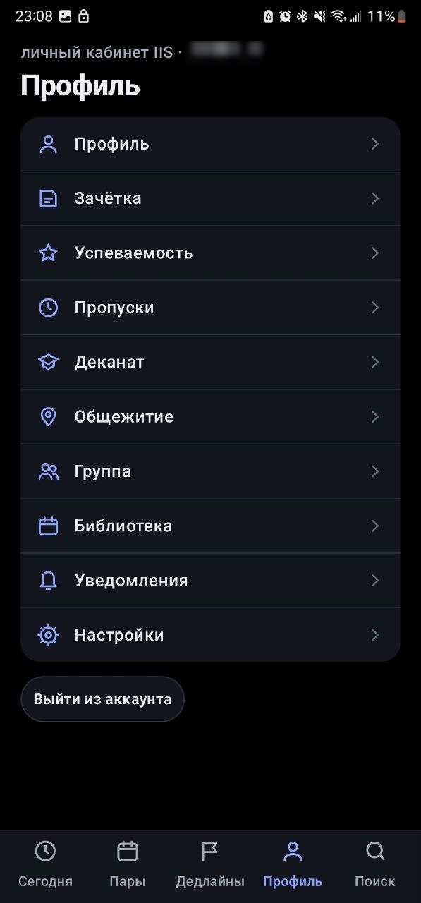

<p align="center">
  
</p>

<h1 align="center">UniTime</h1>

<p align="center">
  <b>Расписание БГУИР в кармане.</b><br>
  Следующая пара на экране блокировки, виджеты, дедлайны, общие окна с друзьями и личный кабинет IIS — в одном приложении.
</p>

<p align="center">
  <a href="https://github.com/molex1le/UniTime/releases/latest"><b>⬇️ Скачать последнюю версию</b></a> · Android 8.0+ · бесплатно, без рекламы
</p>

<p align="center">
  
  
  
  
  
</p>

## Что умеет

**📅 Расписание**
- Следующая пара в уведомлении и на экране блокировки: что, где, во сколько
- Лента пар до конца семестра с переключателем недель, перемены и «окна» между парами
- Номер учебной недели, подгруппы, скрытие ненужных пар
- Поиск по всем группам и преподавателям, фото преподавателей
- Сессия: обратный отсчёт и экзамены

**🧩 Виджеты** — следующая пара (2×1 и 4×2), пары на день, дедлайны, дни до сессии. Светлые и тёмные.

**🚩 Дедлайны** — лабы, рефераты и зачёты по предметам, срок «к следующей паре» в одно нажатие, напоминания за сутки и за 2 часа.

**👥 Друзья** — где сейчас друг и когда у вас общие окна.

**👤 Личный кабинет IIS**
- Зачётка по семестрам, успеваемость и средний балл
- Пропуски с итогом часов, деканат, общежитие, группа, библиотека
- Уведомления о новых оценках, пропусках и сообщениях

**✨ Ещё** — темы (светлая, тёмная, AMOLED и одна секретная 👀), экспорт в Google Календарь, оповещение об изменениях в расписании, обновления прямо из приложения.

## Установка

1. Скачай `UniTime-<версия>.apk` из [Releases](https://github.com/molex1le/UniTime/releases/latest).
2. Открой файл и разреши установку из этого источника.
3. При первом запуске войди через IIS или просто выбери группу.

Дальше UniTime сам сообщает о новых версиях и обновляется в одно нажатие.

## Приватность

- Расписание берётся из открытого API `iis.bsuir.by`, никаких своих серверов.
- Логин и пароль IIS отправляются **только** на `iis.bsuir.by`. Если включить «Запомнить пароль», он хранится на телефоне в зашифрованном виде (ключ в Android Keystore). «Выйти» стирает всё.
- Никакой аналитики и рекламы.

## Для разработчиков

Kotlin · Jetpack Compose · без сторонних библиотек, кроме AndroidX.

```bash
./gradlew assembleDebug
```

APK: `app/build/outputs/apk/debug/UniTime-<версия>-debug.apk`. Нужны JDK 17+ и Android SDK (путь в `local.properties`, `sdk.dir=...`).

### Выпуск версии

1. Поднять `versionCode` и `versionName` в `app/build.gradle.kts`, закоммитить в `main`.
2. Поставить тег; его текст — «что нового», его увидят пользователи:
   ```bash
   git tag -a v3.9 -m "- Что нового" && git push origin v3.9
   ```
   Строка `[важно]` в тексте делает обновление обязательным.
3. GitHub Actions прогонит тесты, соберёт подписанный `UniTime-3.9.apk` и выложит релиз. Установленные приложения раз в день проверяют релизы и предлагают обновиться.

Для подписи в репозитории заданы секреты `NEXTPAIR_KEYSTORE_BASE64`, `NEXTPAIR_STORE_PASSWORD`, `NEXTPAIR_KEY_PASSWORD`, `NEXTPAIR_KEY_ALIAS`.

---

<p align="center">Неофициальное приложение, не связано с БГУИР. Сделано студентом для студентов — by molex1le.</p>
